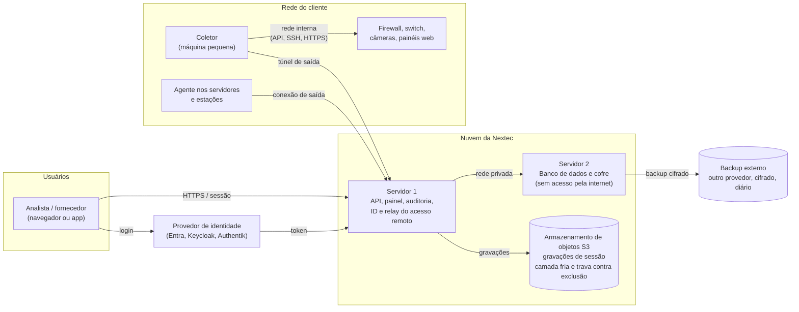

# Projeto Sentinela: arquitetura inicial

Visão inicial da arquitetura, para uma empresa pequena: começa no modo básico e cresce sem refazer o desenho.
Origem: conversa de 17/10/2026 (`nextec/sentinela/ABERTURA.md`). Documento vivo; mudanças entram no histórico no fim.

## 1. Autenticação

```mermaid
sequenceDiagram
    autonumber
    actor U as Analista, fornecedor ou prestador
    participant S as Sentinela (API e painel)
    participant IdP as Provedor de identidade<br/>(Entra primeiro; Keycloak, Authentik ou outro)
    participant C as Cofre
    participant A as Agente ou coletor no cliente

    U->>S: Abre o Sentinela (navegador ou app)
    S->>IdP: Redireciona (OIDC ou SAML)
    U->>IdP: Login com MFA resistente a phishing
    IdP-->>S: Token assinado
    S->>S: Confere grupo, permissões, janela de horário e motivo (chamado)
    S-->>U: Lista só os clientes e máquinas liberados
    U->>S: Clica em conectar
    S->>C: Pede a credencial da conta da máquina
    C-->>S: Credencial (nunca vai ao navegador)
    S->>A: Ordem de conexão com ticket de uso único
    A-->>U: Sessão aberta com a credencial injetada
    A->>S: Fim da sessão: gravação e eventos
    S->>A: Rotaciona a senha usada
```

- O Sentinela não fica preso a um provedor: fala OIDC e SAML genéricos. Trocar de provedor é configuração.
- Fornecedor e prestador entram pelo mesmo caminho, como convidados com prazo de validade.
- Usuário local do próprio Sentinela fica para o futuro (roadmap, etapa 5.11), para quando não houver provedor externo.
- Bloquear o usuário no provedor corta painel, app, sessões abertas e dispara a rotação das senhas que ele usou.

## 2. Infraestrutura (modo básico)



| Peça | Papel | Onde |
| --- | --- | --- |
| Servidor 1 | Recebe o login, decide permissões, serve a interface, orquestra conexões, guarda a auditoria (destino só de escrita) | VPS na Contabo (equivalente ao app01 atual) |
| Servidor 2 | Banco de dados e cofre (senhas, tokens, dados sensíveis), separado do servidor 1 por segurança; só aceita conexão do servidor 1 | VPS na Contabo, sem porta pública (equivalente ao app02 atual) |
| Armazenamento de objetos | Gravações de sessão (o que mais ocupa), com camada fria e trava contra exclusão até o fim da retenção | Serviço compatível com S3 (ex.: bucket da Contabo ou Backblaze) |
| Backup externo | Cópia diária, cifrada, do banco e do cofre; restauração testada | Outro provedor, fora do principal |
| Coletor | Alcança equipamentos sem agente (firewall, switch, câmeras, painéis web), roda o navegador isolado e rotaciona senhas | Máquina pequena dentro de cada cliente |
| Agente | Acesso remoto, rotação das senhas do SO, inventário e RMM | Servidores e estações do cliente |

**Regras do desenho**
- Nada entra na rede do cliente de fora para dentro: coletor e agente sempre abrem a conexão de saída.
- O cofre não tem porta exposta; só o servidor 1 fala com ele, pela rede privada.
- Credencial nunca vai ao navegador do analista; vai ao app por ticket de uso único (e, na Fase 5, nem ao app, com o
  isolamento de sessão).
- Cada cliente tem chave de cifragem própria no cofre.

## 3. Como cresce

| Hoje (básico) | Depois (intermediário em diante) |
| --- | --- |
| 2 VPS | Alta disponibilidade em mais de um local |
| Chave mestra no servidor 2 | Chave mestra em KMS ou HSM |
| Um coletor por cliente | Coletor redundante nos clientes críticos |
| Sessão passa pelo app do analista | Isolamento de sessão por intermediário (Fase 5) |

## Histórico

| Data | Mudança |
| --- | --- |
| 17/10/2026 | Criação |
