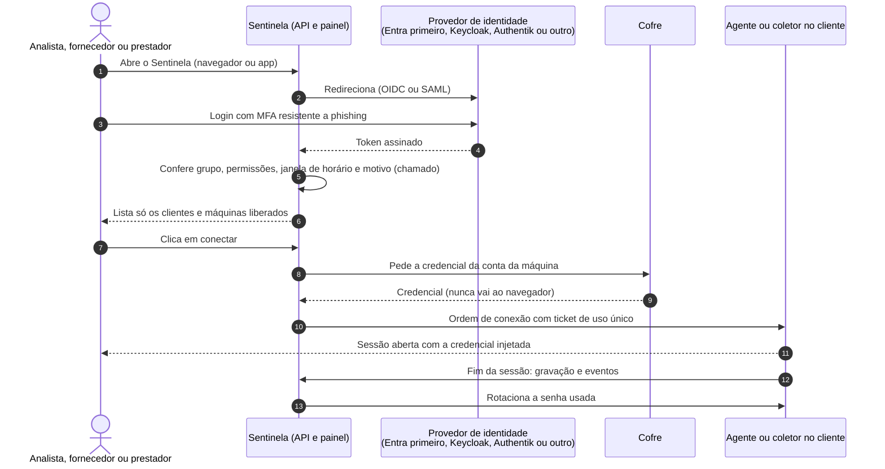
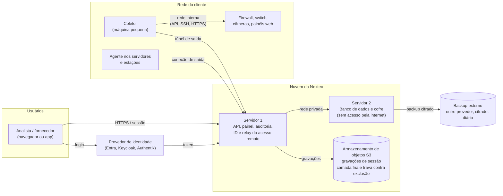
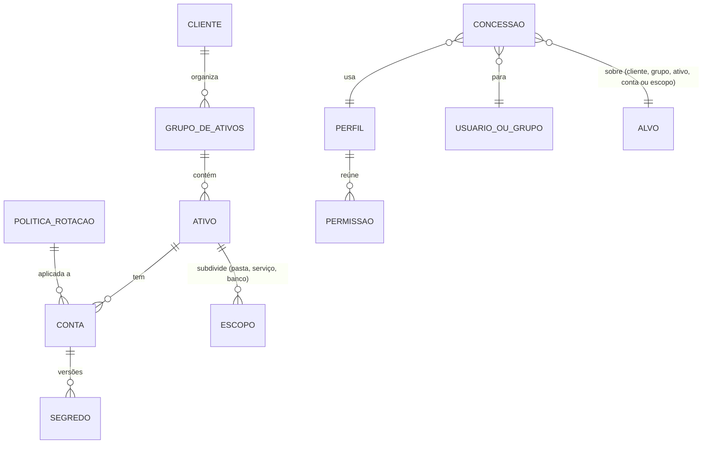

# Projeto Sentinela: arquitetura inicial

Visão inicial da arquitetura, para uma empresa pequena: começa no modo básico e cresce sem refazer o desenho.
Origem: conversa de 17/10/2026 (`nextec/sentinela/ABERTURA.md`). Documento vivo; mudanças entram no histórico no fim.

Os diagramas abaixo estão em Mermaid (o GitHub desenha sozinho) e são a fonte de verdade. As versões de apresentação, na
identidade da Nextec, ficam em `diagramas/autenticacao.png` e `diagramas/infraestrutura.png`, geradas por
`diagramas/gerar.py` (Python com Playwright e a fonte Open Sans do pacote `@fontsource/open-sans`). Ao mudar um diagrama
aqui, atualizar também o `gerar.py` e gerar as imagens de novo.

## 1. Autenticação

- O Sentinela não fica preso a um provedor: fala OIDC e SAML genéricos. Trocar de provedor é configuração.
- Fornecedor e prestador entram pelo mesmo caminho, como convidados com prazo de validade.
- Usuário local do próprio Sentinela fica para o futuro (roadmap, etapa 5.11), para quando não houver provedor externo.
- Bloquear o usuário no provedor corta painel, app, sessões abertas e dispara a rotação das senhas que ele usou.

## 2. Infraestrutura (modo básico)

| Peça | Papel | Onde |
| --- | --- | --- |
| Servidor 1 | Recebe o login, decide permissões, serve a interface, orquestra conexões, guarda a auditoria (destino só de escrita) | VPS na Contabo (equivalente ao app01 atual) |
| Servidor 2 | Banco de dados e cofre (senhas, tokens, dados sensíveis), separado do servidor 1 por segurança; só aceita conexão do servidor 1 | VPS na Contabo, sem porta pública (equivalente ao app02 atual) |
| Armazenamento de objetos | Gravações de sessão (o que mais ocupa), com camada fria e trava contra exclusão até o fim da retenção | Serviço compatível com S3 (ex.: bucket da Contabo ou Backblaze) |
| Backup externo | Cópia diária, cifrada, do banco e do cofre; restauração testada | Outro provedor, fora do principal |
| Coletor | Alcança equipamentos sem agente (firewall, switch, câmeras, painéis web), roda o navegador isolado e rotaciona senhas | Máquina pequena dentro de cada cliente |
| Agente | Acesso remoto, rotação das senhas do SO, inventário e RMM | Servidores e estações do cliente |

**Regras do desenho**
- Nada entra na rede do cliente de fora para dentro: coletor e agente sempre abrem a conexão de saída.
- O cofre não tem porta exposta; só o servidor 1 fala com ele, pela rede privada.
- Credencial nunca vai ao navegador do analista; vai ao app por ticket de uso único (e, na Fase 5, nem ao app, com o
  isolamento de sessão).
- Cada cliente tem chave de cifragem própria no cofre.

## 3. Como cresce

| Hoje (básico) | Depois (intermediário em diante) |
| --- | --- |
| 2 VPS | Alta disponibilidade em mais de um local |
| Chave mestra em cofre de chaves próprio, fora do banco | Chave mestra em KMS ou HSM |
| Um coletor por cliente | Coletor redundante nos clientes críticos |
| Sessão passa pelo app do analista | Isolamento de sessão por intermediário (Fase 5) |

## 4. Decisões técnicas pendentes

Nenhuma no momento. As cinco levantadas em 17/10/2026 viraram as decisões D1 a D6 abaixo.

## 5. Decisões tomadas

### D1. Protocolo entre coletor, agente e Sentinela (17/10/2026)

**Decisão:** gRPC sobre HTTP/2 com mTLS, em túnel reverso aberto pelo coletor ou agente (conexão de saída, permanente).

- Coletor e agente iniciam a conexão; o Sentinela nunca abre conexão para dentro da rede do cliente.
- Autenticação mútua por certificado (mTLS): cada coletor e agente tem identidade própria, emitida na inscrição e
  revogável no painel.
- Uma porta só (443), com roteamento por SNI, para passar em firewalls de cliente sem regra especial.
- Contrato tipado (Protocol Buffers), com streaming para sessões e eventos, e reconexão automática.

**Por quê:** melhor desempenho para streaming de sessão, tipagem forte e padrão de mercado. O Teleport usa o mesmo modelo
(gRPC com mTLS em túnel reverso, SNI numa porta só). A CyberArk mantém os protocolos nativos (RDP, SSH) e intermedeia a
sessão pelo PSM, que grava e consulta o cofre; não usa protocolo de transporte proprietário.

**Alternativa descartada:** WebSocket com mensagens próprias, mais simples de depurar, mas sem contrato tipado nem
streaming nativo equivalente.

**Escopo:** o gRPC é o canal de controle (ordens, credenciais, rotação, inventário, eventos). A sessão remota continua no
protocolo do RustDesk (servidor de ID e relay), que não será trocado. Confirmado em 17/10/2026: o RustDesk não passa pelo
coletor; concentrar a sessão no coletor fica para a Fase 5, junto do isolamento de sessão. O agente atual, que fala HTTPS com a API, pode
continuar assim e migrar para o gRPC quando houver ganho; o coletor, que é novo, já nasce em gRPC.

**Certificados:** ver D8.

### D2. Nenhuma porta de entrada no cliente (17/10/2026)

**Decisão:** RDP, SSH e painéis web dos clientes ficam fechados para a internet. O acesso a eles passa sempre por uma
conexão de saída: o agente (sessão do RustDesk, inclusive o túnel de RDP e o terminal) ou o coletor (RDP, SSH e web pela
rede interna).

| Caminho | Quando usar |
| --- | --- |
| Agente (RustDesk) | Padrão para servidores e estações com o agente instalado: tela, terminal e túnel de RDP |
| Coletor | Equipamento sem agente (firewall, switch, hipervisor, câmeras); contingência quando o agente parar; RDP em sessão própria do usuário em vez do console; SSH com usuário individual no Linux |

**Por quê:** fechar as portas de entrada elimina a maior superfície de ataque (RDP e SSH expostos). Manter RDP e SSH
pela rede interna, via coletor, cobre o que o agente não alcança e dá uma segunda via se o agente cair.

### D3. Modelo de dados do cofre (17/10/2026)

**Decisão:** modelo multicliente desde o início, com a hierarquia abaixo.

| Entidade | O que guarda |
| --- | --- |
| Cliente | Topo da hierarquia (cartório ou empresa); modo de acesso (exclusivo ou compartilhado); chave de cifragem própria |
| Ativo | Recurso do cliente (servidor, firewall, câmera etc.): tipo, fabricante, modelo e forma de conexão |
| Conta | Credencial dentro de um ativo; um ativo pode ter várias (Administrador, root, nominal); cada uma com segredo, política e histórico próprios |
| Segredo | Versionado e nunca sobrescrito: cada rotação cria uma versão nova e marca a anterior como expirada, para auditar quem usou qual senha e quando |
| Grupo de ativos | Agrupamento dentro do cliente (ex.: servidores, rede, câmeras), para aplicar política e permissão em lote |
| Escopo | Parte de um ativo que pode receber permissão própria (ex.: uma pasta, um serviço, um banco de dados) |
| Política de rotação | Modelo configurável: intervalo de tempo, troca após cada uso e se depende de aprovação; aplicada no nível global, do cliente, do grupo de ativos ou da conta |
| Perfil | Conjunto de permissões (ação sobre tipo de recurso, ex.: conectar, ler, revelar senha, alterar configuração); vem com perfis padrão e aceita perfis novos |
| Concessão de acesso | Liga usuário ou grupo a um perfil sobre um alvo (cliente, grupo de ativos, ativo, conta ou escopo), com validade, janela de horário e se exige aprovação |

**Granularidade (definida em 17/10/2026):** nada de valor fixo no código. Política de rotação e permissões são
configuráveis e granulares desde a base, para servir também a um possível produto.

- **Precedência:** a regra mais específica vence (conta, depois grupo de ativos, depois cliente, depois global). Uma
  negação explícita sempre vence uma permissão.
- **Perfis padrão prontos** (ex.: Administrador, Analista N2, Analista N1, Fornecedor, Somente leitura). Qualquer perfil
  novo pode ser criado do zero ou clonado de um padrão.
- **Escopo fino:** o modelo já prevê permissão abaixo do ativo (ex.: só leitura numa pasta de um servidor). A aplicação
  completa disso entra por fases: na Fase 1, concessão por cliente, grupo, ativo e conta; o escopo dentro do ativo
  depende de o agente aplicar a restrição no próprio sistema (ex.: conta temporária com permissão só naquela pasta) e
  fica para quando o RMM estiver pronto.

**Padrões iniciais de rotação** (ponto de partida, ajustáveis por cliente e por conta):

| Tipo de conta | Padrão |
| --- | --- |
| Administrador local, root, domínio e contas nominais com privilégio | Após cada uso e, no máximo, a cada 30 dias |
| Conta de serviço e de aplicação | A cada 60 a 90 dias, só depois do mapeamento de dependências |
| Equipamento de rede e painéis web | A cada 90 dias e após cada uso de escrita |
| Conta de emergência | Só após uso |

**Requisitos de segurança do cofre (obrigatórios na etapa 1.4):**

| Requisito | Como |
| --- | --- |
| Cifragem em camadas | Cada versão do segredo é cifrada com a chave do cliente; a chave do cliente é cifrada pela chave mestra, que fica num cofre de chaves dedicado (ex.: OpenBao ou HashiCorp Vault auto-hospedado, depois KMS ou HSM), nunca no mesmo banco dos dados. Banco vazado sem o cofre de chaves não decifra nada |
| Algoritmo | Cifragem autenticada (AES-256-GCM ou XChaCha20-Poly1305), com nonce único por versão; biblioteca consolidada, nunca criptografia própria |
| Isolamento entre clientes | Toda consulta filtrada por cliente no banco (segurança por linha), além da checagem na aplicação |
| Segredo fora de log e de navegador | Nunca em log, erro, URL ou resposta ao navegador; só sai para o app ou coletor por ticket de uso único |
| Auditoria à prova de alteração | Registro só de inclusão, encadeado por hash, com quem, quando, qual versão e qual motivo (chamado) |
| Menor privilégio no banco | Usuário do banco da aplicação sem permissão de apagar histórico; administração do banco separada |
| Rotação das próprias chaves | Chave de cliente trocável sem parar o serviço (recifrar as versões em segundo plano) |
| Memória | Segredo decifrado só no momento do uso e descartado em seguida |

**Retenção das versões expiradas (definida em 17/10/2026):** configurável por cliente e por tipo de conta, de um dia
até indefinido. Sem configuração, nada é apagado. O prazo nunca fica abaixo do piso legal do cliente (ex.: 5 anos para
cartório). Cada uso de versão registra quem, quando, qual versão e qual motivo.

### D4. Síncrono ou em fila (17/10/2026)

**Decisão:** o que o usuário espera ver na hora é síncrono; o que é pesado ou pode precisar repetir vai para fila em
segundo plano, com a tela mostrando o andamento.

| Síncrono | Em fila |
| --- | --- |
| Login, listar clientes e máquinas, abrir sessão, revelar senha (admin) | Rotação programada por tempo, rotação em massa, relatórios, varredura de vulnerabilidade, atualizações em lote, backup de configuração |

**Exceção de segurança:** a rotação logo após o uso da senha é imediata (síncrona ou com prioridade máxima na fila), para a
senha usada não continuar valendo. Se falhar, gera alerta e nova tentativa; nunca fica esquecida.

Toda tarefa em fila é idempotente (pode rodar de novo sem efeito duplicado) e registra resultado e falha na auditoria.

### D5. Estratégia de testes (17/10/2026)

**Decisão:** abordagem enxuta, sem laboratório caro, e tudo automático.

- Testes automáticos de código (unidade e fluxo) rodando no CI a cada mudança, sem custo.
- Conectores de fabricante testados contra simulação da API de cada fabricante no CI.
- **Verificação real semanal e automática:** um teste agendado roda contra os equipamentos que a Nextec já tem (FortiGate,
  MikroTik, pfSense) e avisa se um conector quebrou, antes do cliente perceber. Cresce conforme entram novos fabricantes.
  Em equipamento de cliente, o teste semanal é só de leitura (versão, login, consulta); teste que altera algo, como
  rotação de senha, roda só em equipamento da própria Nextec.
- Fluxos críticos (login, conexão sem senha, rotação, bloqueio) com teste ponta a ponta antes de cada versão.

### D6. API em duas camadas (17/10/2026)

**Decisão:** separar API interna e API externa.

| Camada | Para quem | Regras |
| --- | --- | --- |
| Interna | Painel e app do Sentinela | Sem documentação pública; pode mudar junto com o painel e o app |
| Externa | Integrações, portal do cliente, MCP (equipe e, no futuro, clientes) | Documentada e versionada (ex.: /v1), com aviso antes de desativar uma versão |

- Toda chamada à API externa tem dono: quem integra é tratado como um usuário dentro do mesmo modelo de concessão (D3),
  com o mesmo escopo granular, auditoria e corte imediato. Nada de token solto sem dono.
- O MCP usa a API externa; nunca um caminho paralelo.
- Tokens de integração com validade e escopo mínimo, revogáveis no painel, e limite de requisições.

### D7. Eixo único de validação (17/10/2026)

**Decisão:** toda entrada (painel, app, API externa e MCP; pessoa, integração ou agente de IA) passa pelo mesmo eixo de
validação do Sentinela, com duas camadas em sequência:

1. **Permissão:** quem é, se a concessão (D3) cobre aquela ação naquele alvo, se está na janela de horário.
2. **Risco:** mesmo com permissão, o comportamento é suspeito? Ex.: volume fora do padrão, horário ou origem incomuns,
   sequência de ações rara para aquele perfil ou que lembra varredura e reconhecimento de rede, pedido de dados de
   muitos clientes de uma vez, token usado de dois lugares ao mesmo tempo.

| Resultado do risco | Ação |
| --- | --- |
| Normal | Passa |
| Suspeito leve | Passa, mas pede MFA de novo ou limita a ação |
| Suspeito | Segura e pede aprovação humana |
| Alto | Bloqueia, derruba a sessão e alerta |

**Cuidados:**
- O eixo não pode virar ponto único de falha: roda em mais de uma instância quando houver alta disponibilidade; se a
  checagem de permissão falhar, nega (falha fechada).
- A checagem de risco precisa ser rápida (triagem leve, como o Jev); a análise profunda roda em paralelo e pode derrubar a
  sessão depois.
- Começa só observando e registrando por um período, para medir alarmes falsos antes de bloquear.
- Toda decisão do eixo vai para a auditoria, com o motivo.

**Por quê:** é o modelo de confiança zero usado no mercado (um ponto que aplica a política e avalia o risco de forma
contínua, não só no login). Evita uma segunda classe de acesso com regras diferentes para API ou IA.

### D8. Certificados do coletor e do agente (17/10/2026)

**Decisão:** o Sentinela é a autoridade certificadora própria (PKI interna), no modelo usado pelo Teleport.

- **Emissão:** na instalação, o coletor ou agente recebe um token de inscrição de uso único e curta duração; com ele se
  registra e recebe o certificado definitivo, gerado com chave privada criada na própria máquina, que nunca sai dela.
- **Validade curta:** cerca de 90 dias (configurável), com renovação automática enquanto o equipamento está saudável.
- **Revogação imediata:** coletor comprometido ou contrato encerrado, o admin revoga no painel e o servidor deixa de
  aceitar a conexão na hora (lista de revogados consultada a cada conexão).
- **Chave da autoridade certificadora** guardada no cofre de chaves dedicado (D3), nunca no banco.

## Histórico

| Data | Mudança |
| --- | --- |
| 17/10/2026 | Criação |
| 17/10/2026 | Imagens dos diagramas em `diagramas/` |
| 17/10/2026 | Decisões técnicas pendentes |
| 17/10/2026 | Imagens refeitas na identidade visual, com gerador versionado |
| 17/10/2026 | D1: gRPC com mTLS entre coletor, agente e Sentinela |
| 17/10/2026 | D2: nenhuma porta de entrada no cliente |
| 17/10/2026 | D1 confirmada (RustDesk direto ao relay); D3: modelo de dados do cofre |
| 17/10/2026 | D3: permissões e rotação granulares, perfis e padrões iniciais |
| 17/10/2026 | D4 síncrono ou em fila, D5 testes, D6 API em duas camadas |
| 17/10/2026 | D7: eixo único de validação (permissão e risco) |
| 17/10/2026 | D8: certificados; D3: chave mestra fora do banco e retenção configurável |
