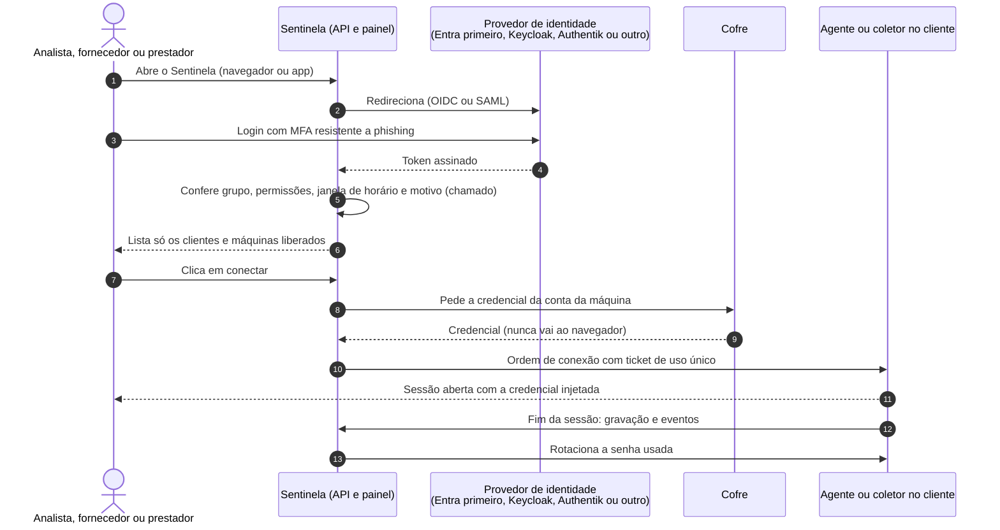
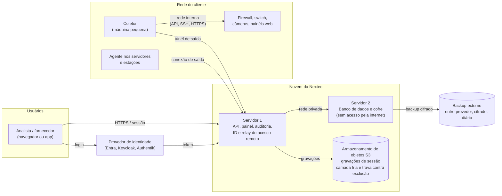

# Projeto Sentinela: arquitetura inicial

Visão inicial da arquitetura, para uma empresa pequena: começa no modo básico e cresce sem refazer o desenho.
Origem: conversa de 17/10/2026 (`nextec/sentinela/ABERTURA.md`). Documento vivo; mudanças entram no histórico no fim.

Os diagramas abaixo estão em Mermaid (o GitHub desenha sozinho) e são a fonte de verdade. As versões de apresentação, na
identidade da Nextec, ficam em `diagramas/autenticacao.png` e `diagramas/infraestrutura.png`, geradas por
`diagramas/gerar.py` (Python com Playwright e a fonte Open Sans do pacote `@fontsource/open-sans`). Ao mudar um diagrama
aqui, atualizar também o `gerar.py` e gerar as imagens de novo.

## 1. Autenticação

- O Sentinela não fica preso a um provedor: fala OIDC e SAML genéricos. Trocar de provedor é configuração.
- Fornecedor e prestador entram pelo mesmo caminho, como convidados com prazo de validade.
- Usuário local do próprio Sentinela fica para o futuro (roadmap, etapa 5.11), para quando não houver provedor externo.
- Bloquear o usuário no provedor corta painel, app, sessões abertas e dispara a rotação das senhas que ele usou.

## 2. Infraestrutura (modo básico)

| Peça | Papel | Onde |
| --- | --- | --- |
| Servidor 1 | Recebe o login, decide permissões, serve a interface, orquestra conexões, guarda a auditoria (destino só de escrita) | VPS na Contabo (equivalente ao app01 atual) |
| Servidor 2 | Banco de dados e cofre (senhas, tokens, dados sensíveis), separado do servidor 1 por segurança; só aceita conexão do servidor 1 | VPS na Contabo, sem porta pública (equivalente ao app02 atual) |
| Armazenamento de objetos | Gravações de sessão (o que mais ocupa), com camada fria e trava contra exclusão até o fim da retenção | Serviço compatível com S3 (ex.: bucket da Contabo ou Backblaze) |
| Backup externo | Cópia diária, cifrada, do banco e do cofre; restauração testada | Outro provedor, fora do principal |
| Coletor | Alcança equipamentos sem agente (firewall, switch, câmeras, painéis web), roda o navegador isolado e rotaciona senhas | Máquina pequena dentro de cada cliente |
| Agente | Acesso remoto, rotação das senhas do SO, inventário e RMM | Servidores e estações do cliente |

**Regras do desenho**
- Nada entra na rede do cliente de fora para dentro: coletor e agente sempre abrem a conexão de saída.
- O cofre não tem porta exposta; só o servidor 1 fala com ele, pela rede privada.
- Credencial nunca vai ao navegador do analista; vai ao app por ticket de uso único (e, na Fase 5, nem ao app, com o
  isolamento de sessão).
- Cada cliente tem chave de cifragem própria no cofre.

## 3. Como cresce

| Hoje (básico) | Depois (intermediário em diante) |
| --- | --- |
| 2 VPS | Alta disponibilidade em mais de um local |
| Chave mestra no servidor 2 | Chave mestra em KMS ou HSM |
| Um coletor por cliente | Coletor redundante nos clientes críticos |
| Sessão passa pelo app do analista | Isolamento de sessão por intermediário (Fase 5) |

## 4. Decisões técnicas pendentes

Levantadas em 17/10/2026; cada uma vira um registro de decisão quando for fechada, antes da etapa da Fase 1 que depende dela.

| Decisão | O que precisa ser definido | Necessária para |
| --- | --- | --- |
| Modelo de dados do cofre | Estrutura cliente, máquina, conta e segredo, isolada por cliente desde o início | 1.4 |
| Síncrono ou assíncrono | O que acontece na hora do clique e o que vai para fila (ex.: rotação após a sessão) | 1.6 e 1.7 |
| Estratégia de testes | Testes dos fluxos críticos e dos conectores por fabricante, que quebram com atualizações | 1.6 e 2.3 |
| Versionamento da API própria | Como versionar a API que serve painel, app e, no futuro, o MCP | 3.12 |

## 5. Decisões tomadas

### D1. Protocolo entre coletor, agente e Sentinela (17/10/2026)

**Decisão:** gRPC sobre HTTP/2 com mTLS, em túnel reverso aberto pelo coletor ou agente (conexão de saída, permanente).

- Coletor e agente iniciam a conexão; o Sentinela nunca abre conexão para dentro da rede do cliente.
- Autenticação mútua por certificado (mTLS): cada coletor e agente tem identidade própria, emitida na inscrição e
  revogável no painel.
- Uma porta só (443), com roteamento por SNI, para passar em firewalls de cliente sem regra especial.
- Contrato tipado (Protocol Buffers), com streaming para sessões e eventos, e reconexão automática.

**Por quê:** melhor desempenho para streaming de sessão, tipagem forte e padrão de mercado. O Teleport usa o mesmo modelo
(gRPC com mTLS em túnel reverso, SNI numa porta só). A CyberArk mantém os protocolos nativos (RDP, SSH) e intermedeia a
sessão pelo PSM, que grava e consulta o cofre; não usa protocolo de transporte proprietário.

**Alternativa descartada:** WebSocket com mensagens próprias, mais simples de depurar, mas sem contrato tipado nem
streaming nativo equivalente.

**Escopo:** o gRPC é o canal de controle (ordens, credenciais, rotação, inventário, eventos). A sessão remota continua no
protocolo do RustDesk (servidor de ID e relay), que não será trocado. O agente atual, que fala HTTPS com a API, pode
continuar assim e migrar para o gRPC quando houver ganho; o coletor, que é novo, já nasce em gRPC.

**A detalhar na etapa 2.1:** emissão, rotação e revogação dos certificados do coletor e do agente.

## Histórico

| Data | Mudança |
| --- | --- |
| 17/10/2026 | Criação |
| 17/10/2026 | Imagens dos diagramas em `diagramas/` |
| 17/10/2026 | Decisões técnicas pendentes |
| 17/10/2026 | Imagens refeitas na identidade visual, com gerador versionado |
| 17/10/2026 | D1: gRPC com mTLS entre coletor, agente e Sentinela |
